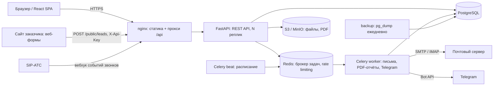
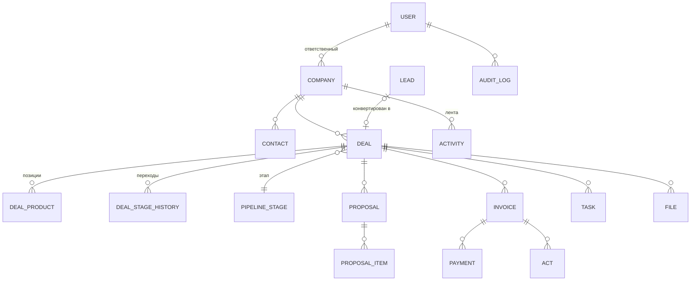

# Архитектура

## Выбор: модульный монолит

ТЗ (п. 4.4) допускает модульный монолит или микросервисы с обоснованием. Выбран **модульный монолит**:

- **Масштаб задачи.** 50 пользователей на старте и до 500 через 2–3 года — нагрузка, с которой одно stateless-приложение
  с горизонтальным масштабированием справляется с большим запасом. Микросервисы оправданы при десятках команд
  и независимых релизах, а не при такой нагрузке.
- **Транзакционная целостность.** Конвертация лида создаёт компанию, контакт, сделку, историю и ленту событий
  в одной транзакции БД. В микросервисах для этого понадобились бы саги и компенсации.
- **Стоимость владения.** Один репозиторий, одна БД, один деплой: проще поддержка, мониторинг, резервное
  копирование и обучение команды заказчика.
- **Путь к разделению.** Модули изолированы (`api/v1/*`, `services/*`), общаются через сервисный слой.
  Фоновые процессы (почта, отчёты, напоминания) уже вынесены в отдельные процессы Celery. При необходимости
  модуль (например, аналитику) можно выделить в сервис без переписывания остальной системы.

## Компоненты

| Компонент | Технология | Назначение |
|---|---|---|
| Frontend | React 18, TypeScript, Mantine, TanStack Query | SPA, раздаётся nginx |
| API | FastAPI, SQLAlchemy 2, Pydantic 2 | REST `/api/v1`, OpenAPI на `/api/docs` |
| БД | PostgreSQL 16 | Основное хранилище, миграции Alembic |
| Кэш и очередь | Redis 7 | Брокер Celery, счётчики rate limiting |
| Фоновые задачи | Celery worker + beat | Письма, напоминания (раз в минуту), отчёты по расписанию, IMAP (раз в 2 мин), Telegram, дайджест «зависших» сделок |
| Файлы | S3-совместимое (MinIO, Yandex Object Storage) | Вложения, КП, логотип |
| PDF | WeasyPrint + Jinja2 | КП, счета, акты, отчёты |

## Модули бэкенда

| Модуль | Файлы | Ответственность |
|---|---|---|
| Аутентификация | `api/v1/auth.py`, `core/security.py` | JWT, ротация refresh-токенов, 2FA, блокировка при переборе |
| Права | `core/permissions.py`, `services/access.py` | Матрица прав ролей, фильтрация «только свои данные» |
| Клиенты | `api/v1/companies.py`, `contacts.py` | Карточки, фильтры, дубли по ИНН |
| Лиды | `api/v1/leads.py`, `services/leads.py` | Регистрация, распределение, конвертация |
| Сделки | `api/v1/deals.py` | Воронка, канбан, история этапов, позиции |
| Задачи | `api/v1/tasks.py`, `worker/tasks.py` | Задачи, календарь, ICS, напоминания |
| Коммуникации | `api/v1/activities.py`, `services/mailer.py`, `telephony.py` | Лента, почта с трекингом, телефония, файлы |
| КП и финансы | `api/v1/proposals.py`, `finance.py`, `services/documents.py` | КП, счета, оплаты, акты, 1С |
| Аналитика | `api/v1/analytics.py`, `services/analytics.py` | Дашборд, отчёты, конструктор, экспорт |
| Импорт и поиск | `api/v1/data.py` | CSV/Excel, выгрузки, глобальный поиск |
| Публичный API | `api/v1/public.py` | Приём лидов, трекинг-пиксель, онлайн-КП |

## Модель данных

Основные сущности ТЗ (п. 5.2) реализованы с расширениями: `users`, `companies`, `contacts`, `leads`, `deals`,
`tasks`, `activities`, `files` (Document), а также `deal_products`, `deal_stage_history`, `proposals`, `invoices`,
`payments`, `acts`, `dictionary_items`, `pipeline_stages`, `products`, `custom_fields`, `audit_log`,
`email_messages`, `notifications`, `marketing_spend`, `report_schedules`, `api_keys`.

Решения:

- **Мягкое удаление** компаний, контактов, лидов и сделок (`deleted_at`): данные восстанавливаются, удаление
  фиксируется в аудите.
- **Пользовательские поля** хранятся в JSONB-колонке `custom_fields` с валидацией по описанию полей.
- **История этапов** хранит время пребывания на предыдущем этапе, поэтому отчёт «среднее время прохождения»
  считается без тяжёлых вычислений.
- **Суммы** — `NUMERIC(14,2)`; мультивалютные сделки приводятся к рублям по курсам из настроек.

## Безопасность

| Угроза | Мера |
|---|---|
| Перебор паролей | 10 попыток входа в минуту с IP; блокировка учётной записи на 15 минут после 5 ошибок |
| Кража токена | Access-токен живёт 15 минут; refresh-токены одноразовые (ротация), повторное использование отзывает все сессии |
| Утечка БД | Пароли — bcrypt (12 раундов); телефоны — AES-128-CBC + HMAC (Fernet), поиск по «слепому индексу» HMAC-SHA256; TOTP-секреты зашифрованы |
| Доступ к чужим данным | Каждый запрос фильтруется по роли (`services/access.py`); чужой объект возвращает 404, а не 403, чтобы не раскрывать факт его существования |
| SQL-инъекции | Только параметризованные запросы SQLAlchemy |
| XSS | React экранирует вывод; PDF-шаблоны — Jinja2 с автоэкранированием; заголовки `X-Content-Type-Options`, `X-Frame-Options` |
| Злоупотребление API | Rate limiting 100 запр./мин на пользователя (Redis), 30/мин на публичный приём лидов; API-ключи хранятся в виде SHA-256 |
| Действия сотрудников | Журнал аудита: входы, удаления, изменения сумм и ролей, экспорт, импорт, выгрузки в 1С — с IP и diff |
| Загрузка файлов | Лимит 25 МБ, имена нормализуются, файлы хранятся под случайными ключами |

## Производительность и масштабирование

- API не хранит состояние: сессии — JWT, файлы — S3, очередь и лимиты — Redis. Реплики backend добавляются
  без изменений кода (`docker compose up -d --scale backend=3` за балансировщиком или Kubernetes Deployment).
- Все списки — серверная пагинация, сортировка и фильтры с индексами по полям фильтрации; при 10 000+ записей
  клиенту передаётся только текущая страница.
- Тяжёлые операции (письма с вложениями, отчёты по расписанию, разбор почты) выполняются в Celery и не
  блокируют пользователя; воркеры масштабируются отдельно.
- Под 500 пользователей: 3–4 реплики API × 4 воркера uvicorn, PostgreSQL на выделенном сервере (4 vCPU / 16 ГБ)
  с репликой для отчётов, Redis с persistence.

## Тестирование

- `backend/tests` — 33 интеграционных теста API на реальной PostgreSQL: авторизация, 2FA, ротация токенов,
  блокировка, rate limiting, шифрование, права ролей, конвертация лидов, жизненный цикл сделки, напоминания,
  КП с публичным согласованием, счета, оплаты, акты, 1С, отчёты и экспорт, импорт, поиск, аудит, телефония, трекинг писем.
- `backend/tests/load/locustfile.py` — нагрузочный сценарий для п. 8.2 ТЗ.
